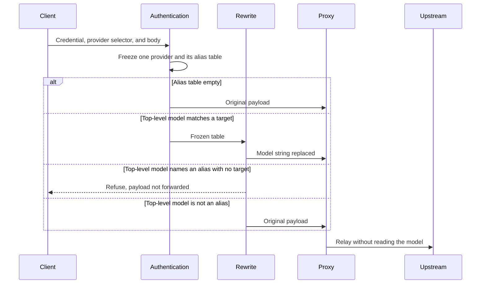

# Model rewrite

## Purpose

Replace one caller-facing model name with the upstream model name of the provider the request has
already resolved to.

## Design

The rewrite runs after authentication and route validation and before the proxy
([ADR 0020](../adr/0020-model-alias-request-rewrite.md)). Provider selection is unchanged: the
credential bindings and the dedicated selection header still choose exactly one provider, and the
alias table is not an input to that choice.

Authentication freezes, into the request snapshot, the account's alias names that matter for that
one provider. A name with a target for the provider is paired with that target's upstream model
name. A name the account owns that has no target for the provider is recorded as unavailable. An
account with no aliases freezes an empty table. The table is immutable for the life of the request.
A later edit is visible only to the next request.

An empty table skips the adapter. The body and any WebSocket message are not read.

A non-empty table makes the adapter look for a single top-level JSON string named `model`:

- On HTTP, the search covers a bounded prefix of the request body. Bytes after the prefix stream
  through. The body is never accumulated in full. When the replacement changes the length, the
  upstream request no longer claims the client's original length.
- On WebSocket, the search covers each client text message. Those messages are already bounded by
  the connection limits. Binary frames, control frames, and upstream messages are unchanged. The
  model name is not on the upgrade request, so this happens after the handshake the route requires.

Matching is exact on the decoded string. The stored upstream name is written back as a JSON string,
including the escapes that string requires. The surrounding bytes stay as they were. One alias is
resolved once; the upstream name is not itself treated as an alias.

A nested `model`, a `model` inside a string, and a second top-level `model` are not rewritten. A
second top-level `model`, a top-level `model` that is not a string, or a prefix that ends inside
that string fails the rewrite. A payload that is not a JSON object, or that has no top-level
`model` inside the prefix, is forwarded unchanged. A string that is not one of the account's alias
names is forwarded unchanged, so a caller can still name the provider's own model.

The walk follows strings and container nesting. It does not validate numbers, literals, or nested
keys. A prefix it cannot follow before it has identified a top-level `model` string is forwarded
unchanged.

The adapter does not inject a missing model, does not rewrite responses, and does not contact an
upstream. The proxy core still does not read application fields; it forwards the bytes the adapter
handed it. Neither name is written to a log, an event, or a metric.

## Core flows

## Invariants

- The adapter runs only after exactly one provider has been resolved, and it never changes that
  provider.
- An empty alias table causes no read of a body or a WebSocket message.
- At most one top-level `model` string is replaced, and only when it equals an alias name for this
  provider.
- A replacement cannot grow the gateway's memory with the unread remainder of the body.
- Alias edits do not change a snapshot that was already frozen.
- Failure before forwarding does not send the caller-facing name upstream.
- Logs, events, and metrics carry neither the alias name nor the upstream model name.

## Failures and bounds

- An alias with no target for the selected provider fails with `model_alias_unavailable` and `400`
  on HTTP, before any upstream connection. On WebSocket the same condition closes the relay without
  forwarding the message.
- A top-level `model` that is not one unambiguous string fails with `invalid_model_field` and `400`
  on HTTP, and closes the WebSocket relay the same way. The error carries neither name.
- The HTTP search is limited to a fixed prefix. A `model` string that begins past that prefix is
  left unchanged.
- The frozen table is limited by the account's alias cap. A read that exceeds the cap fails closed
  instead of dropping names.
- A body that fails while the prefix is being read fails closed before an upstream connection.
